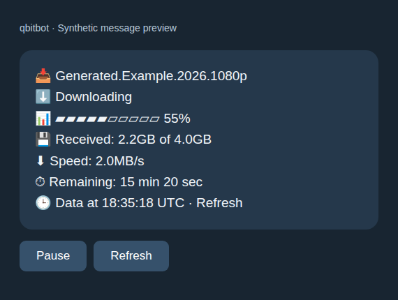
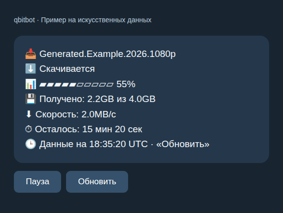

# qbitbot

Search torrents and manage qBittorrent downloads from Telegram, in English or Russian.
Run the bot, qBittorrent and Jackett together with Docker Compose, or connect the bot
to services you already operate.

[English setup](docs/setup.en.md) · [Установка на русском](docs/setup.ru.md)

## What it does

- Search Jackett, choose quality/size filters, compare release details and confirm a download.
- Use compact numbered buttons, progress cards, pause/resume and confirmed deletion.
- Receive completion notifications and keep an hourly service-health card.
- Detect English/Russian from Telegram or save a preference with `/language`.
- Preserve subscriptions, queued notifications, health cards and language choices through restarts.

All allowlisted users administer the entire connected qBittorrent library. Deletion
removes the torrent **and its files**, after confirmation. Jackett indexers require
manual setup; no tracker accounts or credentials are supplied. Direct Telegram file
uploads and media-app integration are outside this release.

## Installation

Use Docker with Compose v2 on Linux amd64 for the verified target.
qBittorrent **5.x** is required; the bundled version is **5.3.0**.

| Setup | When to use it |
| --- | --- |
| [Bundled stack](docs/setup.en.md#bundled-bot-qbittorrent-and-jackett) | Install the bot, qBittorrent and Jackett together. |
| [Bot-only mode](docs/setup.en.md#existing-qbittorrent-and-jackett) | Connect to qBittorrent and Jackett you already operate. |

Follow the [English](docs/setup.en.md) or [Russian](docs/setup.ru.md) guide to
configure private credentials, set the Telegram allowlist and run the setup check
before starting the bot. The check verifies service access without polling
Telegram or adding torrents. Jackett indexers must be configured manually.

For indexers requiring browser challenges, enable the optional
[FlareSolverr overlay](docs/deployment/flaresolverr.md). Its API stays on a private
Docker network shared with Jackett, with no published host port.

## NAS support

**Tested on QNAP with Container Station and Docker Compose (Linux amd64 / x86_64).**
Public v0.3.0 passed live Telegram acceptance on this platform. Run the bundled
stack for a new installation, or use bot-only mode with existing qBittorrent and
Jackett services. See the [English](docs/setup.en.md#nas-installation) or
[Russian](docs/setup.ru.md#установка-на-nas) NAS setup notes.
Other NAS platforms and ARM architectures have not been verified.

## Preview

Synthetic examples rendered from the bot's message formatters; these are not live chats.




## Operations

[Backup/restore](docs/backup.en.md) · [Копирование и восстановление](docs/backup.ru.md)

[Troubleshooting](docs/troubleshooting.en.md) · [Устранение неполадок](docs/troubleshooting.ru.md)

Normal restarts and upgrades retain named state volumes. Back up the bot databases
and service configuration before upgrades; `docker compose down -v` deletes named
state/configuration volumes. Before reusing an existing bot volume, follow the
[offline ownership migration guide](docs/deployment/container-hardening.md).

No prebuilt registry image is published. Compose builds the bot and patched service
images from the reviewed Dockerfiles.

## Security and verification

Current `main` includes updated dependency pins, patched service images, a non-root
bot with a read-only application filesystem and resource limits, and validated
HTTP destinations with bounded metadata responses. Optional FlareSolverr also runs
non-root/read-only and verifies TLS certificates; its Chromium browser retains
upstream's disabled internal sandbox. Its isolation and remaining limits are
explained in the [FlareSolverr guide](docs/deployment/flaresolverr.md).

Web management interfaces bind to localhost by default. Keep them private, retain
service authentication and protect `.env`/`bot.env`; never commit credentials or
run two bot instances with the same Telegram token.

Automated verification includes offline tests, disposable API/recovery checks and
weekly dependency/image security scans. The dated
[security review](docs/deployment/security-hardening-2026-10-24.md) records the
2026-10-24 scan results and remaining limits; scans need repeating as advisories
and packages change. Check [GitHub Actions](https://github.com/Nerfagol/qbitbot/actions)
for the status of a particular commit.

The operator confirmed live Telegram acceptance of **v0.3.0** on 2026-09-27;
see its [acceptance record](docs/acceptance-v0.3.0.md). Later security and setup
changes are documented in the [changelog](CHANGELOG.md); that historical record
does not certify every later revision or platform.

## Development

Use Python 3.12:

```sh
python3.12 -m venv .venv
.venv/bin/python -m pip install -r requirements-dev.lock
make check
make compose-check
make integration
make integration-public
```

Unit tests block networking. Docker checks create and remove only their own isolated
resources. `make integration-public` requires Compose 2.24.4+ and Git history for its
original-public-code rollback rehearsal. See [contributor guidance](AGENTS.md),
[source layout](docs/development/layout.md),
[localization](docs/development/localization.md) and the [release checklist](docs/release-checklist.md).

## License

Original project code is MIT licensed. Dependencies and service images retain their
own licenses; see [third-party notices](THIRD_PARTY_NOTICES.md).
