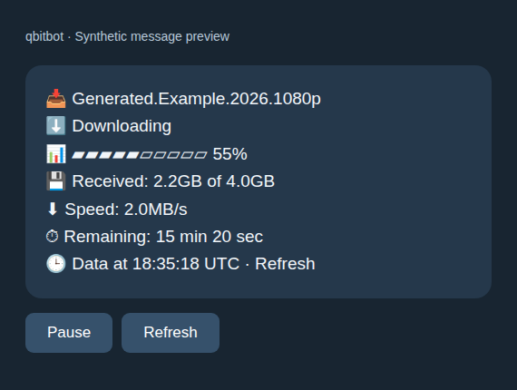
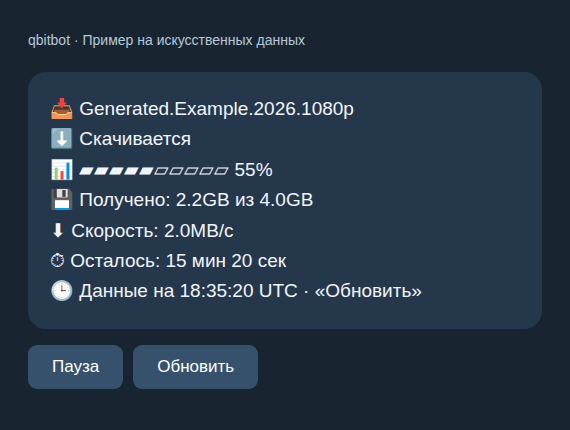

# qbitbot

[](https://github.com/Nerfagol/qbitbot/actions/workflows/check.yml)
[](https://github.com/Nerfagol/qbitbot/actions/workflows/containers.yml)
[](https://github.com/Nerfagol/qbitbot/actions/workflows/security.yml)
[](https://github.com/Nerfagol/qbitbot/actions/workflows/codeql.yml)

Search torrents and manage qBittorrent downloads from Telegram, in English or Russian.
Run the bot, qBittorrent and Jackett together with Docker Compose, or connect the bot
to services you already operate.

[English setup](docs/setup.en.md) · [Установка на русском](docs/setup.ru.md) · [Documentation](docs/README.md)

## What it does

- Search Jackett, choose quality/size filters, compare release details and confirm a download.
- Use compact numbered buttons, progress cards, pause/resume and confirmed deletion.
- Receive completion notifications and keep an hourly service-health card.
- Detect English/Russian from Telegram or save a preference with `/language`.
- Preserve subscriptions, queued notifications, health cards and language choices through restarts.

All allowlisted users administer the entire connected qBittorrent library. Deletion
removes the torrent **and its files**, after confirmation. Jackett indexers require
manual setup; no tracker accounts or credentials are supplied. Direct Telegram file
uploads and media-app integration are outside this release.

## Installation

Use Docker with Compose v2 on Linux amd64 for the verified target.
qBittorrent **5.x** is required; the bundled version is **5.3.0**.

| Setup | When to use it |
| --- | --- |
| [Bundled stack](docs/setup.en.md#bundled-bot-qbittorrent-and-jackett) | Install the bot, qBittorrent and Jackett together. |
| [Bot-only mode](docs/setup.en.md#existing-qbittorrent-and-jackett) | Connect to qBittorrent and Jackett you already operate. |

Follow the [English](docs/setup.en.md) or [Russian](docs/setup.ru.md) guide to
configure private credentials, set the Telegram allowlist and run the setup check
before starting the bot. The check verifies service access without polling
Telegram or adding torrents. Jackett indexers must be configured manually.

### Quick start from source

```sh
git clone https://github.com/Nerfagol/qbitbot.git
cd qbitbot
cp .env.example .env
cp config/bot.env.example bot.env
chmod 600 .env bot.env
mkdir -p downloads
```

Set the download directory, its owner IDs and any alternate ports in `.env` using
the [setup guide](docs/setup.en.md#bundled-bot-qbittorrent-and-jackett), then build
and start the services:

```sh
docker compose build
docker compose up -d qbittorrent jackett
```

Follow the guide to set a qBittorrent password, configure Jackett indexers and fill
`bot.env` with your service credentials, Telegram token and allowed user IDs.
Then check the configuration and start the bot:

```sh
docker compose run --rm --no-deps bot python -m qbitbot.cli.setup_check && \
docker compose up -d bot
```

Open `/start` in Telegram. For existing qBittorrent/Jackett installations, follow
the [bot-only instructions](docs/setup.en.md#existing-qbittorrent-and-jackett).

For indexers requiring browser challenges, enable the optional
[FlareSolverr overlay](docs/deployment/flaresolverr.md). Its API stays on a private
Docker network shared with Jackett, with no published host port.

## NAS support

**Tested on QNAP with Container Station and Docker Compose (Linux amd64 / x86_64).**
Public v0.3.0 passed live Telegram acceptance on this platform. Run the bundled
stack for a new installation, or use bot-only mode with existing qBittorrent and
Jackett services. See the [English](docs/setup.en.md#nas-installation) or
[Russian](docs/setup.ru.md#установка-на-nas) NAS setup notes.
Other NAS platforms and ARM architectures have not been verified.

## Preview

Synthetic examples rendered from the bot's message formatters; these are not live chats.




## Operations

[Backup/restore](docs/backup.en.md) · [Копирование и восстановление](docs/backup.ru.md)

[Troubleshooting](docs/troubleshooting.en.md) · [Устранение неполадок](docs/troubleshooting.ru.md)

Normal restarts and upgrades retain named state volumes. Back up the bot databases
and service configuration before upgrades; `docker compose down -v` deletes named
state/configuration volumes. Before reusing an existing bot volume, follow the
[offline ownership migration guide](docs/deployment/container-hardening.md).

Use the [GHCR release-image overlays](docs/deployment/registry.md) for versioned
Linux amd64 pulls after package publication/visibility verification. Default
Compose builds the bot and patched service
images from the reviewed Dockerfiles in `deploy/docker/`. The bot runtime installs
a built wheel; its code and both locale catalogs live in `src/qbitbot/`. See
[layout upgrade notes](deploy/README.md#upgrade-from-the-former-root-layout) when
updating an older checkout.

For source-build upgrades, follow the [English](docs/setup.en.md#upgrading) or
[Russian](docs/setup.ru.md#обновление) instructions. A source update needs an image
rebuild and container recreation before its fixes reach a running installation.

## Security and verification

Current `main` includes updated dependency pins, patched service images, a non-root
bot with a read-only application filesystem and resource limits, and validated
HTTP destinations with bounded metadata responses. Optional FlareSolverr also runs
non-root/read-only and verifies TLS certificates; its Chromium browser retains
upstream's disabled internal sandbox. Its isolation and remaining limits are
explained in the [FlareSolverr guide](docs/deployment/flaresolverr.md).

Web management interfaces bind to localhost by default. Keep them private, retain
service authentication and protect `.env`/`bot.env`; never commit credentials or
run two bot instances with the same Telegram token.

Automated verification includes offline tests, disposable API/recovery checks,
CodeQL Python analysis, secret scanning, PR dependency review and weekly
dependency/image security scans. See [current image inputs and dated scan evidence](docs/deployment/images.md)
and [GitHub Actions](https://github.com/Nerfagol/qbitbot/actions) for a particular
commit. Scans need repeating as advisories and packages change; the
[security review](docs/archive/security/security-hardening-2026-10-24.md) documents
the original hardening scope and remaining limits.

The operator confirmed live Telegram acceptance of **v0.3.0** on 2026-09-27;
see its [acceptance record](docs/archive/acceptance-v0.3.0.md). Later security and setup
changes are documented in the [changelog](CHANGELOG.md); that historical record
does not certify every later revision or platform.

## Development

Use Python 3.12 and install the host `jq` command (used by the offline Jackett
startup-helper tests; the Jackett image already includes it):

```sh
python3.12 -m venv .venv
make install-dev
make check
make compose-check
make integration
make integration-public
```

Unit tests block networking. Docker checks create and remove only their own isolated
resources. `make integration-public` requires Compose 2.24.4+ and Git history for its
original-public-code rollback rehearsal. See [contributor guidance](AGENTS.md),
[source layout](docs/development/layout.md),
[localization](docs/development/localization.md) and the [release checklist](docs/development/releases.md).

Build a distributable wheel with `make wheel`. See [packaging](docs/development/packaging.md)
for version ownership, artifact checks and installation outside the checkout.

## License

Original project code is MIT licensed. Dependencies and service images retain their
own licenses; see [third-party notices](docs/licenses/THIRD_PARTY_NOTICES.md).
